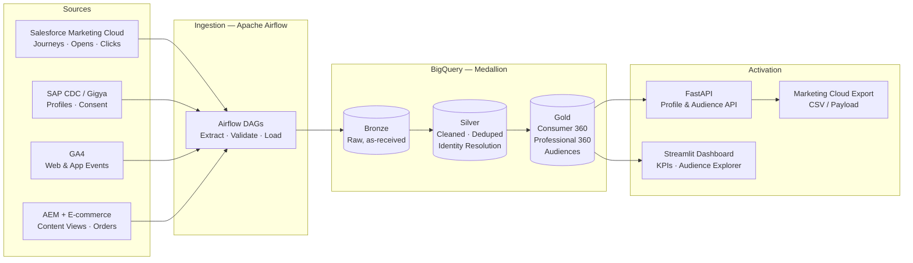

# Consumer360 — Customer Data Platform (CDP)

> **End-to-end Data Cloud-style CDP on GCP** — unify consumer & professional data from Salesforce Marketing Cloud, SAP Customer Data Cloud, Google Analytics 4, and Adobe Experience Manager into a single 360° profile, resolve identity, build audiences, and activate them back for marketing.


*Demo: Airflow ingestion → identity resolution → unified profile → audience builder → activation export & KPI dashboard*

---

## Overview

Consumer & professional data lives in silos. Marketing has email engagement in **Salesforce Marketing Cloud**, identity & consent lives in **SAP CDC (Gigya)**, behaviour lives in **GA4**, content & commerce lives in **AEM / E-commerce**. No single team can answer: *Who is this person, what did they consent to, what have they engaged with, and should they be in this audience?*

Consumer360 solves that — the way a production Customer Data Platform does:

1. **Ingest** first-party data from 4 source systems on a schedule
2. **Resolve identity** across email, phone, device, and CDC ID into one golden profile
3. **Enforce consent & governance** — opted-out profiles never reach activation
4. **Model audiences** for consumers *and* dental/health professionals separately
5. **Activate** — export audience payloads in Marketing Cloud format and measure KPIs

Built as a portfolio implementation of a **Lead Data Engineer** workload: data-cloud architecture, global consumer/professional data models, cross-platform integration, and marketing activation — not just an ETL job.

---

## Architecture



**Stack:** Python · SQL · Apache Airflow · Google BigQuery · dbt · FastAPI · Streamlit · Docker · Great Expectations

---

## Key Features

### 1. Multi-Source Ingestion
- Airflow DAGs per source with retries, backfills, and data contracts
- Incremental loads using watermark timestamps; idempotent re-runs
- Raw data preserved in Bronze — every Gold record is traceable to source

### 2. Identity Resolution (Silver)
The core of any Data Cloud. One person, many identifiers:

| Match Type | Keys | Confidence |
|---|---|---|
| Deterministic | `cdc_id`, verified email, phone | 1.00 |
| Linked | Marketing Cloud `subscriber_key` ↔ CDC ID map | 0.95 |
| Probabilistic | Name + DOB + ZIP, device ID overlap | 0.70–0.89 |

- Survivorship rules: most recent verified value wins; consent is *never* overwritten by a weaker source
- Output: one `golden_profile_id` per real person, with a full identity graph table showing every linked identifier

### 3. Global Consumer & Professional Data Models (Gold)
Two distinct models, one governance standard — mirroring real consumer-products businesses that market to both shoppers and professionals:

- **`dim_consumer_360`** — profile, consent, lifecycle stage, preferred category, engagement score
- **`dim_professional_360`** — dental/health professionals, speciality, practice, professional engagement
- **`fact_engagement`** — unified event stream (email, web, content, purchase) keyed to the golden profile
- **`fact_orders`** — product purchases by category (Oral Care, Personal Care, Home Care)

### 4. Consent & Governance
- SAP CDC consent is the source of truth — marketing consent, profiling consent, and third-party sharing tracked separately
- Opted-out or consent-expired profiles are **hard-excluded** from every audience and export, enforced in dbt — not in the dashboard
- PII is hashed/tokenised in Silver; raw PII only exists in restricted Bronze tables

### 5. Audience Builder
Define audiences as versioned dbt models / SQL rules, not ad-hoc queries:

| Audience | Rule (example) |
|---|---|
| Whitening Intenders | Viewed whitening content on AEM in 30d + email click in 30d + no whitening purchase in 90d |
| Lapsed Buyers | Purchased Oral Care 60–120d ago + no order since + marketing consent = true |
| Engaged Professionals | Professional profile + opened 2+ clinical emails in 45d + speciality = Orthodontics |
| New & Nurturable | Registered in CDC in 14d + no purchase yet + GA4 session in 7d |

Each audience ships with: size, consent-clean count, channel reachability (email / mobile), and a diff vs. last run.

### 6. Activation & KPIs
- **FastAPI:** `GET /profiles/{id}`, `GET /audiences`, `POST /audiences/{id}/activate` — API-gateway-ready (Apigee-style versioning & API-key auth)
- **Activation export:** Marketing Cloud-ready CSV/payload per audience, with an activation log
- **Dashboard:** identity match rate, profile growth, consent rate, audience sizes, engagement & conversion KPIs

---

## Project Structure

```
consumer360/
│
├── README.md
├── LICENSE
├── .gitignore
├── .env.example                    # TARGET=local|gcp, API keys, GCP project, BQ dataset
├── requirements.txt                # API + dashboard + pipeline deps
├── requirements-dev.txt            # pytest, GE, linting
├── pyproject.toml                  # Package config, ruff/black, pytest settings
├── Makefile                        # make setup / generate / run / test / demo
├── docker-compose.yml              # Airflow + Postgres + API + Dashboard
├── Dockerfile.api
├── Dockerfile.dashboard
│
├── config/
│   ├── settings.py                 # Env-based config (local DuckDB / GCP BigQuery switch)
│   ├── sources.yaml                # Source systems, tables, watermarks, schedules
│   ├── identity_rules.yaml         # Match keys, confidence scores, survivorship rules
│   └── audiences.yaml              # Audience definitions, channels, refresh cadence
│
├── src/
│   └── consumer360/
│       ├── __init__.py
│       │
│       ├── connectors/             # One connector per source system (real schemas, synthetic transport)
│       │   ├── __init__.py
│       │   ├── base.py             # BaseConnector: extract / validate / watermark logic
│       │   ├── sfmc.py             # Salesforce Marketing Cloud — journeys, sends, opens, clicks, bounces
│       │   ├── sap_cdc.py          # SAP CDC / Gigya — profiles, consent, subscriptions
│       │   ├── ga4.py              # GA4 — sessions, pageviews, events, device IDs
│       │   └── aem_commerce.py     # AEM content views + e-commerce orders / line items
│       │
│       ├── ingestion/
│       │   ├── __init__.py
│       │   ├── loader.py           # Bronze loader — raw, as-received, + _loaded_at / _source_file
│       │   ├── watermarks.py       # Incremental watermark store & idempotent re-runs
│       │   └── contracts.py        # Source data contracts (schema, null-rate, freshness)
│       │
│       ├── identity/
│       │   ├── __init__.py
│       │   ├── resolver.py         # Deterministic + linked + probabilistic matching engine
│       │   ├── graph.py            # Identity graph build (identifier -> golden_profile_id)
│       │   └── survivorship.py     # Golden-record rules: most-recent verified wins, consent never downgraded
│       │
│       ├── activation/
│       │   ├── __init__.py
│       │   ├── exporter.py         # Audience -> Marketing Cloud-ready CSV / JSON payload
│       │   └── activation_log.py   # Who/what/when per activation, dedupe guard
│       │
│       └── utils/
│           ├── __init__.py
│           ├── hashing.py          # PII hashing / tokenisation (SHA-256 + salt)
│           ├── logging.py
│           └── dates.py
│
├── data/
│   ├── synthetic/
│   │   ├── generate.py             # CLI: --profiles 10000 --seed 42 (reproducible)
│   │   ├── generators/
│   │   │   ├── people.py           # Consumers + dental/health professionals, intentional duplicates across sources
│   │   │   ├── sfmc_engagement.py
│   │   │   ├── sap_cdc_profiles.py
│   │   │   ├── ga4_events.py
│   │   │   └── aem_commerce.py     # Content views, orders — Oral / Personal / Home Care
│   │   └── output/                 # Generated files land here (gitignored)
│   │       ├── sfmc_engagement.csv
│   │       ├── sap_cdc_profiles.csv
│   │       ├── ga4_events.csv
│   │       └── aem_commerce.csv
│   ├── seeds/                      # Reference data (committed)
│   │   ├── product_catalog.csv     # SKU, category, brand
│   │   ├── country_market.csv      # Market, language, currency, consent regime
│   │   └── professional_specialities.csv
│   └── samples/                    # Tiny committed samples so reviewers can run without generating
│       └── (10-row version of each source file)
│
├── airflow/
│   ├── dags/
│   │   ├── consumer360_daily.py    # Master DAG: ingest -> dbt -> quality -> activation
│   │   ├── ingest_sfmc.py
│   │   ├── ingest_sap_cdc.py
│   │   ├── ingest_ga4.py
│   │   └── ingest_aem_commerce.py
│   ├── plugins/
│   │   └── operators/
│   │       └── bronze_load_operator.py
│   └── requirements.txt
│
├── dbt/
│   ├── dbt_project.yml
│   ├── profiles.yml                # local (DuckDB) + gcp (BigQuery) targets
│   ├── packages.yml                # dbt-utils, dbt-expectations
│   ├── macros/
│   │   ├── hash_pii.sql
│   │   ├── consent_filter.sql      # THE guardrail macro — used by every audience model
│   │   └── generate_golden_id.sql
│   ├── seeds/
│   │   └── (symlink / copy of data/seeds)
│   ├── snapshots/
│   │   ├── snap_consumer_profile.sql   # SCD2 — profile & consent history
│   │   └── snap_consent.sql
│   ├── models/
│   │   ├── sources.yml             # Source declarations + freshness checks for all 4 systems
│   │   ├── bronze/
│   │   │   ├── _bronze.yml
│   │   │   ├── stg_sfmc_engagement.sql
│   │   │   ├── stg_sap_cdc_profiles.sql
│   │   │   ├── stg_ga4_events.sql
│   │   │   ├── stg_aem_content.sql
│   │   │   └── stg_commerce_orders.sql
│   │   ├── silver/
│   │   │   ├── _silver.yml
│   │   │   ├── int_profiles_cleaned.sql        # Normalised emails/phones, deduped
│   │   │   ├── int_identity_matches.sql        # Pairwise matches + confidence scores
│   │   │   ├── int_identity_graph.sql          # Resolved golden_profile_id per identifier
│   │   │   ├── int_consent_latest.sql          # Latest consent state per profile (CDC = truth)
│   │   │   └── int_engagement_unified.sql      # Email + web + content events in one stream
│   │   ├── gold/
│   │   │   ├── _gold.yml
│   │   │   ├── dim_consumer_360.sql
│   │   │   ├── dim_professional_360.sql
│   │   │   ├── fact_engagement.sql
│   │   │   ├── fact_orders.sql
│   │   │   └── agg_kpi_daily.sql               # Profiles, match rate, consent rate, engagement
│   │   └── audiences/
│   │       ├── _audiences.yml
│   │       ├── aud_whitening_intenders.sql
│   │       ├── aud_lapsed_buyers.sql
│   │       ├── aud_engaged_professionals.sql
│   │       ├── aud_new_nurturable.sql
│   │       └── aud_audience_summary.sql        # Size, consent-clean count, reachability, diff vs last run
│   └── tests/
│       ├── assert_no_audience_without_consent.sql
│       ├── assert_no_duplicate_golden_profiles.sql
│       └── assert_activation_matches_audience.sql
│
├── data_quality/
│   ├── great_expectations/
│   │   ├── great_expectations.yml
│   │   ├── expectations/
│   │   │   ├── sfmc_suite.json
│   │   │   ├── sap_cdc_suite.json
│   │   │   ├── ga4_suite.json
│   │   │   └── gold_suite.json     # Golden profiles unique, consent enforced, KPIs sane
│   │   └── checkpoints/
│   │       └── daily_checkpoint.yml
│   └── run_checks.py
│
├── api/
│   ├── main.py                     # FastAPI app — /v1, API-key auth, OpenAPI docs
│   ├── deps.py                     # Warehouse connection, auth dependency
│   ├── routers/
│   │   ├── profiles.py             # GET /v1/profiles/{golden_profile_id} · GET /v1/profiles/search
│   │   ├── audiences.py            # GET /v1/audiences · GET /v1/audiences/{id}/members (paginated)
│   │   ├── activation.py           # POST /v1/audiences/{id}/activate · GET /v1/activations
│   │   └── kpis.py                 # GET /v1/kpis/daily
│   ├── schemas/
│   │   ├── profile.py
│   │   ├── audience.py
│   │   └── activation.py
│   └── services/
│       ├── profile_service.py
│       ├── audience_service.py
│       └── activation_service.py
│
├── dashboard/
│   ├── app.py                      # Streamlit entry point
│   └── pages/
│       ├── 1_overview.py           # KPI cards: golden profiles, match rate, consent rate, revenue
│       ├── 2_profile_explorer.py   # Search a person -> full 360 timeline across all 4 sources
│       ├── 3_identity_graph.py     # Visualise how identifiers merged into one golden profile
│       ├── 4_audience_builder.py   # Audience sizes, rules, consent-clean counts, activate button
│       └── 5_data_quality.py       # GE + dbt test results, source freshness
│
├── infra/
│   ├── terraform/                  # Optional GCP mode
│   │   ├── main.tf                 # BigQuery datasets (bronze/silver/gold), GCS bucket, service account
│   │   ├── variables.tf
│   │   └── outputs.tf
│   └── gcp/
│       └── setup.md                # Manual GCP setup if not using Terraform
│
├── scripts/
│   ├── run_pipeline.sh             # generate -> ingest -> dbt run -> dbt test -> GE checks
│   ├── run_demo.sh                 # One command: full pipeline + API + dashboard for recording demo.gif
│   └── export_audience.py          # CLI activation export without the API
│
├── tests/
│   ├── unit/
│   │   ├── test_identity_resolution.py   # Match scoring, transitive merges, no false merges
│   │   ├── test_survivorship.py
│   │   ├── test_consent_exclusion.py     # Opted-out profile can NEVER enter an audience
│   │   └── test_hashing.py
│   ├── integration/
│   │   ├── test_ingestion_to_bronze.py
│   │   ├── test_api_profiles.py
│   │   └── test_api_activation.py
│   └── e2e/
│       └── test_full_pipeline.py         # Synthetic data in -> golden profiles + audiences out
│
├── docs/
│   ├── demo.gif
│   ├── architecture.md             # Deep dive: medallion design, BigQuery partitioning/clustering
│   ├── data_model.md               # ER diagram + column dictionary for Gold tables
│   ├── identity_resolution.md      # Matching logic, confidence thresholds, worked example
│   ├── governance.md               # Consent model, PII handling, market rules
│   └── interview_notes.md          # Design trade-offs & how each JD requirement maps to this project
│
└── .github/
    └── workflows/
        ├── ci.yml                  # Lint + unit tests + dbt compile on PR
        └── pipeline_smoke_test.yml # Weekly: full synthetic pipeline end-to-end
```

---

## Quick Start

```bash
# 1. Clone
git clone https://github.com/sajansshergill/consumer360.git
cd consumer360

# 2. Run everything locally (BigQuery is emulated with DuckDB by default)
docker compose up -d

# 3. Generate synthetic source data & run the pipeline
python -m data.synthetic.generate --profiles 10000
airflow dags trigger consumer360_daily

# 4. Build Gold models
cd dbt && dbt run && dbt test

# 5. Explore
# Dashboard:  http://localhost:8501
# API docs:   http://localhost:8000/docs
```

> **Real GCP mode:** set `TARGET=gcp` and provide a service-account key — the same dbt models run against BigQuery with no SQL changes except the profile config.

---

## Data Quality & Testing

- **Great Expectations** on ingestion: schema, null-rate, and referential checks per source
- **dbt tests:** uniqueness on `golden_profile_id`, no audience member without valid consent, no duplicate activation exports
- **Unit tests:** identity-resolution survivorship and consent-exclusion logic — the two places a CDP can silently do real harm if wrong

---

## Sample Results

| Metric | Result (10k synthetic profiles) |
|---|---|
| Source records ingested | 48,200 |
| Golden profiles resolved | 9,140 (1.14 identifiers merged per profile avg.) |
| Deterministic match rate | 87% |
| Consent-clean reachable audience | 78% of golden profiles |
| Pipeline runtime (local) | < 4 min end-to-end |

*Synthetic data only — numbers demonstrate the pipeline, not a production deployment.*

---

## Design Decisions

| Decision | Why |
|---|---|
| Medallion (Bronze/Silver/Gold) in BigQuery | Replayable, auditable, and separates raw fidelity from business logic |
| dbt for all transformations | Versioned, tested, documented models — the data model *is* the code |
| Consent enforced in Gold, not at export | An export-time filter gets forgotten. A model-level rule cannot be bypassed. |
| Consumers & Professionals as separate Gold models | Different attributes, different consent regimes, different activation — forcing them into one table creates a model nobody trusts |
| Synthetic source connectors | Salesforce / SAP / Adobe licences aren't public. The connectors implement each system's real schema & semantics so the integration logic is genuine. |

---

## Roadmap

- [ ] Streaming ingestion for GA4 events (Pub/Sub → BigQuery)
- [ ] Zero-ETL / data-sharing pattern to mirror Salesforce Data Cloud federation
- [ ] Audience activation to a live Marketing Cloud sandbox via REST API
- [ ] ML propensity model (next-best-category) as a Gold feature table
- [ ] Lineage & catalogue export (DataHub / OpenLineage from Airflow + dbt)

---

## Author

**Sajan Shergill** — Data Engineer
Python · SQL · Airflow · Spark · dbt · Snowflake / BigQuery · AWS / GCP · Docker

[GitHub](https://github.com/sajansshergill) · [LinkedIn](https://www.linkedin.com/in/sajansshergill)

---

*Portfolio project. All data is synthetic. Salesforce, SAP, Google Analytics, and Adobe are trademarks of their respective owners; this project is not affiliated with or endorsed by them.*
